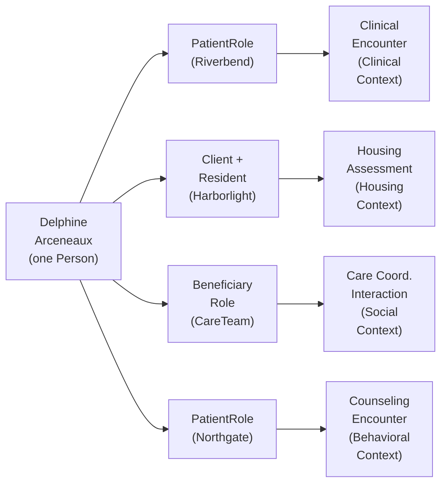

# Care Team Coordination: A Patient Discharge Home User Story

Oct 22, 2026 · Eric Jahn

## Overview

A hospital, a housing agency and a behavioral health clinic coordinate one person's discharge home, and every system involved describes that person through UCM participation rather than its own siloed record. The story is built on the classes in `unified-care-model.ttl` (v0.0.1, `latest` tag) and the layered architecture in `ucm-architecture.md`.

It is written to show four UCM ideals at work:

- **Stable identity, contextual roles.** One `Person` holds a `PatientRole`, a `ClientRole` and a `ResidentRole` at the same time, each through its own `Participation`.
- **Context separate from statement.** Every assertion is a `Statement` made within a `SemanticContext` and governed by a `DefinitionArtifact`, so its meaning travels with it.
- **Negotiated coordination.** Care team membership is established through a `CoordinationRequest` and `Handshake`, not assumed.
- **Care trajectory time.** Events are ordered by where they sit in the care process, even when exact timestamps are missing.

All people and organizations are fictional.

## Personas

Six fictional people and four fictional organizations. Each person is one stable `Person`; the roles column lists what they take on through participation, never what they are.

| Persona | Who they are | Roles assumed (context) | What they need |
| --- | --- | --- | --- |
| **Delphine Arceneaux**, 67 | Retired city bus driver with COPD and recurring depression. Admitted after a COPD flare; her apartment lease ends in three weeks. | `PatientRole` (Clinical Care), `ClientRole` and `ResidentRole` (Housing), `BeneficiaryRole` (Social Care), `PatientRole` (Behavioral Health) | To go home to somewhere safe and tell her story once, not five times. |
| **Tomasz Brennan**, RN | Care transitions coordinator at Riverbend General Hospital. | `CoordinatorRole` then `ProviderRole` (Clinical Care) | One view of who is on Delphine's team, what each has agreed to, and what is still open before discharge. |
| **Amara Lindqvist** | Housing navigator at Harborlight Housing Collaborative. | `ProviderRole` (Housing Eligibility) | A housing referral that already carries verified identity and context, so she isn't re-screening from scratch. |
| **Priya Castellanos**, LCSW | Behavioral health counselor at Northgate Community Mental Health. | `ProviderRole` (Behavioral Health) | To join the team without exposing therapy notes beyond what Delphine has consented to share. |
| **Jules Arceneaux** | Delphine's nephew, 34, shares her new household after discharge. | `CaregiverRole` (Social Care); household member | To know what he is responsible for at home and who to call. |
| **Samuel Whitfield** | Community health worker with the Eastside Neighbors network. | `CoordinatorRole` after discharge (Social Care) | A clean handoff of open tasks when the hospital steps back. |

**Organizations:** Riverbend General Hospital, Harborlight Housing Collaborative and Northgate Community Mental Health are each an `Organization`. Eastside Neighbors is a `CommunityGroup`.

**Device:** Delphine's home pulse oximeter is a `Device` whose readings become `ObservationStatement`s.

## User story

> **As a** care transitions coordinator (Tomasz),
> **I want** to form a cross-domain care team around one person, where each member joins by agreement and every shared statement carries its context,
> **so that** Delphine leaves the hospital to stable housing with clinical, behavioral health and home support already in place, and nobody has to re-collect her story.

Supporting stories from the same team:

- **As a** housing navigator (Amara), **I want** referrals to arrive with a confirmed identity match and the clinical context they were made in, **so that** I can start the housing assessment the same day.
- **As a** behavioral health counselor (Priya), **I want** to accept a team invitation on terms that limit what I share, **so that** I can coordinate without breaching Delphine's consent.
- **As a** person receiving care (Delphine), **I want** to be the same person to every organization even though each sees me in a different role, **so that** my needs are understood as one life, not five cases.

### Scenario: Delphine's discharge home

1. **Admission.** Delphine is admitted to Riverbend for a COPD flare. The admission is a `ClinicalEncounter` in which she participates in a `PatientRole` within the `ClinicalCareContext`. Her attending records a `DiagnosisStatement`.
2. **A social need surfaces.** During a routine screening, Delphine says her lease ends in three weeks. Tomasz records a `SocialCareStatement` and opens a `CareCoordinationInteraction` whose `ActivityFocus` is "safe discharge to stable housing."
3. **Matching identity.** Harborlight already has Delphine in its homeless management system as "D. Arceneaux." A `MatchClaim` asserts that the hospital record and Harborlight's record refer to the same `Person`. No new person is created; the two organizations now point at one identity.
4. **Asking for help.** Tomasz sends a `CoordinationRequest` to Harborlight and to Northgate. Each request starts a `Handshake` that `negotiates` the shared coordination process.
5. **Agreeing to participate.** Amara `acceptsRequest` for Harborlight as is. Priya accepts for Northgate under a `PolicyDefinition` that keeps therapy notes inside the `BehavioralHealthContext`; only a summary `CareCoordinationStatement` is shared. Delphine agrees that Jules joins as her caregiver.
6. **The care team forms.** A `CareTeam` now `hasMember` Delphine, Tomasz, Amara, Priya and Jules. Each holds a `Membership` governed by the team's `MembershipCriteria` (consent on file, an accepted handshake) and each membership has a `validFrom` date.
7. **Housing assessment.** Amara runs a `HousingAssessment` in which Delphine is the resident (`hasResident`). The resulting `HousingEligibilityStatement` is `madeWithinContext` the `HousingEligibilityContext`, which is `definedByArtifact` an `EligibilityRuleset`. The program's actual income threshold lives in the implementation model, not in UCM.
8. **Ordering without timestamps.** Harborlight's system only records the referral acceptance date, not the time. The team still knows the referral was accepted after the housing assessment and before discharge, because each event carries a `CareTrajectoryContext` relative to the coordination process.
9. **Discharge and handoff.** Delphine is discharged to a new apartment she shares with Jules, a `Household`. Tomasz's `CoordinatorRole` participation ends (`validTo`). Samuel takes on the `CoordinatorRole` in the `SocialCareContext`. Tomasz stays on the team in a `ProviderRole` for the 7-day follow-up call. Same people, new roles.
10. **Living at home.** Her pulse oximeter readings arrive as `ObservationStatement`s `generatedByProcess` home monitoring. Samuel sees that the team is still active, who is on it, and which roles each member holds today.

## Acceptance criteria

The story is done when a UCM-conformant graph of the scenario can answer each of these:

- [ ] **One person, many roles.** Delphine is a single `Person` with at least four concurrent `Participation`s, each `assumesRole` a different `Role` and each `scopedBy` a different `SemanticContext`.
- [ ] **Identity is resolved, not duplicated.** A `MatchClaim` links the hospital and Harborlight references, and no second `Person` exists for Delphine.
- [ ] **Membership is negotiated.** Every `CareTeam` member except Delphine traces back to a `Handshake` that `negotiates` the `CareCoordinationInteraction`, and an `acceptsRequest` by that member or their organization.
- [ ] **Membership is governed.** Each `Membership` points to the team through `membershipIn`, and the team is `definedByCriteria` a `MembershipCriteria`.
- [ ] **Every statement has context.** Each `Statement` has a `madeWithinContext`, a `statementDate` and a `statementSubject` participation. Eligibility statements also reach their `EligibilityRuleset` through `definedByArtifact`.
- [ ] **Consent limits are visible.** Northgate's participation is constrained by a `PolicyDefinition`, and no `ClinicalStatement` from the `BehavioralHealthContext` is exposed outside it.
- [ ] **Coordination has a focus and a state.** The `CareCoordinationInteraction` `hasActivityFocus` safe discharge to stable housing and `hasLifecycleState` showing requested, active and handed off.
- [ ] **Order survives missing timestamps.** The referral acceptance can be placed after the housing assessment and before discharge using `hasCareTrajectoryContext` alone.
- [ ] **Roles change, people don't.** Tomasz's `CoordinatorRole` participation has a `validTo`; Samuel's begins on or after it; Tomasz's `ProviderRole` participation continues. No `Person` record changes.

## Participation view

Delphine never changes. What differs across domains is the `Participation` she enters, the `Role` it assumes, and the `SemanticContext` that scopes it.

## Ontology mapping

Every story element maps to a class or property already in `unified-care-model.ttl`; nothing new had to be invented.

| Story element | UCM term | Layer |
| --- | --- | --- |
| Delphine, Tomasz, Amara, Priya, Jules, Samuel | `Person` (≡ NCBITaxon 9606, SNOMED CT 337915000, CCO Person) | Core |
| Riverbend, Harborlight, Northgate | `Organization`, linked by `affiliatedWith` | Core |
| Eastside Neighbors | `CommunityGroup` ⊂ `SocialGroupEntity` | Core |
| Delphine and Jules's apartment | `Household` ⊂ `SocialGroupEntity`; `locatedAt` a `Location` | Core |
| Pulse oximeter | `Device` | Core |
| The care team | `CareTeam`, `hasMember`, `Membership`, `membershipIn`, `MembershipCriteria`, `definedByCriteria` | Core + Participation |
| Patient, client, resident, beneficiary | `PatientRole`, `ClientRole`, `ResidentRole`, `BeneficiaryRole` ⊂ `SubjectRole` | Participation |
| Coordinator, provider, caregiver | `CoordinatorRole`, `ProviderRole`, `CaregiverRole` | Participation |
| Each person's involvement | `Participation`, `participatesThrough`, `assumesRole`, `occursWithin`, `scopedBy`, `validFrom` / `validTo`, `enactiveDuring` | Participation |
| Admission | `ClinicalEncounter` ⊂ `Encounter`, `hasPatient` | Clinical domain |
| Discharge coordination | `CareCoordinationInteraction`, `hasActivityFocus` → `ActivityFocus`, `hasLifecycleState` | Process |
| Referral and agreement | `CoordinationRequest`, `Handshake` ⊂ `CoordinativeActivity`, `negotiates`, `acceptsRequest` | Process |
| Housing assessment | `HousingAssessment`, `hasResident` | Housing domain |
| Eligibility result | `HousingEligibilityStatement`, `HousingEligibilityContext`, `EligibilityRuleset`, `definedByArtifact` | Housing domain |
| Consent limit on therapy notes | `PolicyDefinition`, `BehavioralHealthContext` | Core + Behavioral Health |
| Diagnosis, readings, screening note, team summary | `DiagnosisStatement`, `ObservationStatement`, `SocialCareStatement`, `CareCoordinationStatement`; `madeWithinContext`, `statementSubject`, `statementDate`, `generatedByProcess` | Core |
| Same person in two systems | `MatchClaim` ⊂ `Statement` | Core |
| "After assessment, before discharge" | `CareTrajectoryContext`, `hasCareTrajectoryContext`; clock time via `occursDuring` | Core (time) |

**Gaps the story exposed** (worth raising with the group):

- `acceptsRequest` has range `ucm:ParticipationContext`, which is not declared as a class. The story reads more naturally if the range is `CoordinationRequest`.
- `ucm-architecture.md` lists `RiskAssessmentStatement` and `CareRecommendationStatement`, and the arch spec describes `MemberRole` and `Eligibility`, but none are in the TTL yet. A care plan recommendation is a natural next step for this story.
- `ActivityFocus` and `CareTrajectoryContext` have no superclass, so they sit outside the Core hierarchy.
