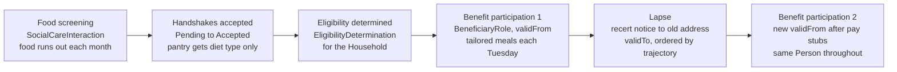

# Care Team Coordination: Nutrition Assistance User Story

Oct 23, 2026 · Eric Jahn

## Overview

Six weeks after the discharge in the [first story](care-team-coordination-discharge.md), Delphine is losing weight and skipping meals, and her care team pulls in a dietitian, a food benefits caseworker and a food pantry. All people, organizations and programs are fictional.

This story adds three UCM ideals the first one only touched:

- **Food is a subject area, not a new domain.** Per arch spec §12.3, nutrition is expressed with existing Core, Participation, Social Care and Public Health terms. No `Nutrition*` class is needed.
- **Eligibility is shared; policy stays out.** The `EligibilityDetermination` pattern is the same one housing used. The program's income limit lives in the implementation model (arch spec §40), not in UCM.
- **The household is a group, and participation has a lifecycle.** Benefits are granted to a `Household` whose `Membership` matters, and Delphine's benefit participation is suspended and reinstated without her identity changing (arch spec §29).

## Personas

Four returning personas and three new ones. Each is one `Person`; the roles column lists what they take on in this story.

| Persona | Who they are | Roles assumed (context) | What they need |
| --- | --- | --- | --- |
| **Delphine Arceneaux**, 67 *(returning)* | Retired bus driver with COPD. Now housed with her nephew, but breathless at meals and down 4 kg since discharge. | `PatientRole` (Clinical Care), `BeneficiaryRole` (Social Care), `ClientRole` (benefits) | Food she can actually eat, without filling out the same forms for three agencies. |
| **Jules Arceneaux**, 34 *(returning)* | Delphine's nephew; works evening shifts at a warehouse. Shares the apartment and groceries. | `CaregiverRole` (Social Care); `Household` member | To know whether his paycheck counts against her benefits, and what he should cook. |
| **Samuel Whitfield** *(returning)* | Community health worker with Eastside Neighbors, Delphine's coordinator since discharge. | `CoordinatorRole` (Social Care) | One place to see what each partner agreed to do and what is overdue. |
| **Tomasz Brennan**, RN *(returning)* | Care transitions coordinator at Riverbend General. | `ProviderRole` (Clinical Care) | To hand the nutrition issue to the right people and close his follow-up loop. |
| **Hana Okonkwo**, RD *(new)* | Registered dietitian in Riverbend's pulmonary clinic. | `ProviderRole` (Clinical Care) | Weight and intake data from home, and a way to order meals that a pantry can fill. |
| **Luis Ferreira** *(new)* | Benefits caseworker at the Bramble County Department of Human Services. | `ProviderRole` (Social Care, eligibility) | A complete household picture up front, so a determination isn't delayed by missing members. |
| **Margit Halvorsen** *(new)* | Volunteer lead at the Eastside Neighbors Food Pantry, which also runs a medically tailored meals list. | `ProviderRole` (Social Care) | To know who is coming, what diet they need, and that the referral is real, without seeing their medical record. |

**Organizations:** Riverbend General Hospital and Bramble County Department of Human Services are each an `Organization`. Eastside Neighbors, which runs the pantry, is a `CommunityGroup`.

**Program:** The FreshPlate Food Benefit is a fictional county-administered grocery benefit, described by a `ProgramDefinition` and an `EligibilityRuleset`.

**Device:** A bluetooth bathroom scale is a `Device` whose readings arrive as `ObservationStatement`s.

## User story

> **As a** community health worker coordinating care (Samuel),
> **I want** a clinical nutrition concern, a household benefit determination and a pantry meal plan to run as one coordinated activity on Delphine's existing care team,
> **so that** she gets enough of the right food quickly, and a lapse in any one piece is visible to everyone before it becomes a crisis.

Supporting stories from the same team:

- **As a** dietitian (Hana), **I want** home weight readings and my diet recommendation to reach the pantry as a statement with its context, **so that** the meals match what I prescribed.
- **As a** benefits caseworker (Luis), **I want** the household's members and income asserted once, with their source, **so that** I can decide eligibility without a second interview.
- **As a** pantry volunteer lead (Margit), **I want** to see only the diet type and pickup details, **so that** I can serve Delphine without holding her medical record.
- **As a** caregiver (Jules), **I want** to know that I count as household for benefits but not as a patient, **so that** I understand what is asked of me.

### Scenario: from weight loss to steady meals

1. **The signal.** Delphine's scale sends weekly `ObservationStatement`s, each `generatedByProcess` home monitoring. Over six weeks they show a 4 kg drop.
2. **Clinical review.** At a pulmonary clinic `ClinicalEncounter`, Hana records a weight `ObservationStatement` and a `DiagnosisStatement` of moderate malnutrition, both `madeWithinContext` the `ClinicalCareContext`.
3. **Social screening.** Samuel runs a food screening as a `SocialCareInteraction` that `hasClient` Delphine. His `SocialCareStatement` records that the household runs out of food before the end of each month.
4. **A new focus on the same team.** Samuel opens a second `CareCoordinationInteraction` whose `ActivityFocus` is "food security." The discharge interaction from the first story is already closed. The `CareTeam` is the same; Hana joins it through a new `Membership`.
5. **Requests and handshakes.** Samuel sends a `CoordinationRequest` to Bramble County DHS and another to the Eastside pantry. Each `Handshake` moves from Pending to Accepted. Margit's acceptance carries a `PolicyDefinition`: the pantry receives the diet type (soft texture, high protein) and nothing from the `ClinicalCareContext`.
6. **Matching identity.** The county already knows Jules from an earlier application and has Delphine under her former surname. A `MatchClaim` links each county record to the existing `Person`. No new person is created.
7. **The household is the unit.** The FreshPlate benefit goes to a `Household`, not a person. The household `hasMember` Delphine and Jules and is `definedByCriteria` a `MembershipCriteria` (they buy and prepare food together). Jules's wages enter as a `SocialCareStatement` about the household, not as a new HouseholdIncome class (arch spec §37.3).
8. **Eligibility.** Luis runs an `EligibilityDetermination` in which Delphine and Jules each participate in a `ClientRole`. The result is a `SocialCareStatement` `madeWithinContext` the `SocialCareContext` and `definedByArtifact` FreshPlate's `EligibilityRuleset`. The county's actual income limit is implementation model policy, not UCM. Delphine then holds a `BeneficiaryRole` participation with a `validFrom`.
9. **Meals.** Hana's diet recommendation reaches the pantry as a `CareCoordinationStatement`. Margit adds Delphine to the tailored meals list. Jules picks up the box each Tuesday at the pantry `Location`, participating in a `CaregiverRole`.
10. **A lapse.** Five months later the county's recertification notice goes to Delphine's old apartment. Her benefit participation is suspended. Nobody knows the exact day it stopped, but it sits after the recertification due date and before Samuel notices, through `hasCareTrajectoryContext`.
11. **Reinstated.** Samuel sees the suspension on the team view the same week. Jules sends his pay stubs, Luis reinstates the benefit, and a new participation opens with its own `validFrom`. Delphine's weight readings level off. Her identity never changed through any of it.

## Acceptance criteria

The story is done when a UCM-conformant graph of the scenario can answer each of these:

- [ ] **No new domain.** Every node in the graph uses a term already in `unified-care-model.ttl`. Nothing is named `Nutrition*` or `Food*`.
- [ ] **One team, two focuses.** The same `CareTeam` is linked to two `CareCoordinationInteraction`s, each with a different `hasActivityFocus`.
- [ ] **Household is first-class.** The benefit determination is about a `Household` with two members, and each member's `Membership` uses `membershipIn` to point to it.
- [ ] **Income is a statement, not a class.** Jules's wages appear only as a `Statement` with a `statementDate` and a `statementSubject`.
- [ ] **Policy stays outside.** The `EligibilityRuleset` is referenced by `definedByArtifact`; no income threshold value appears in the UCM graph.
- [ ] **The pantry sees only what was agreed.** No `ClinicalStatement` is visible to the pantry's participation; its access is constrained by a `PolicyDefinition`.
- [ ] **Handshakes have state.** Each `Handshake` `negotiates` the food security interaction and `hasLifecycleState` Accepted.
- [ ] **A lapse is visible.** Delphine's first `BeneficiaryRole` participation has a `validTo`; the reinstated one has a later `validFrom`; the gap is ordered with `hasCareTrajectoryContext` even though its start date is unknown.
- [ ] **One identity throughout.** County, hospital and pantry references resolve through `MatchClaim`s to the same two `Person`s.

## Benefit lifecycle

The suspension is shown by closing one participation and opening another, because the TTL only gives lifecycle state to processes (see gaps below).

## Ontology mapping

Every element maps to a term already in `unified-care-model.ttl` or `ucm-lifecycle-vocabularies.ttl`, except the lifecycle states noted under gaps.

| Story element | UCM term | Layer |
| --- | --- | --- |
| Delphine, Jules, Samuel, Tomasz, Hana, Luis, Margit | `Person` | Core |
| Riverbend, Bramble County DHS | `Organization`, `affiliatedWith` | Core |
| Eastside Neighbors and its pantry | `CommunityGroup`; pantry is a `Location` (`locatedAt`) | Core |
| Delphine and Jules's grocery unit | `Household`, `hasMember`, `Membership`, `membershipIn`, `MembershipCriteria`, `definedByCriteria` | Core + Participation |
| Bluetooth scale | `Device` | Core |
| FreshPlate Food Benefit | `ProgramDefinition`, `EligibilityRuleset` | Core (definition artifacts) |
| Pantry data limit | `PolicyDefinition` | Core |
| Clinic visit | `ClinicalEncounter`, `hasPatient` | Clinical domain |
| Food screening | `SocialCareInteraction`, `hasClient` | Social Care domain |
| Benefit decision | `EligibilityDetermination` | Process |
| Food security coordination | `CareCoordinationInteraction`, `hasActivityFocus` → `ActivityFocus` | Process |
| Referrals and agreement | `CoordinationRequest`, `Handshake`, `negotiates`, `acceptsRequest`, `hasLifecycleState` (Pending, Accepted) | Process + lifecycle vocabulary |
| Roles | `PatientRole`, `ClientRole`, `BeneficiaryRole`, `CaregiverRole`, `CoordinatorRole`, `ProviderRole` | Participation |
| Benefit start, lapse, reinstatement | `Participation`, `validFrom` / `validTo`, `enactiveDuring` | Participation |
| Weight, malnutrition, food shortage, income, diet order | `ObservationStatement`, `DiagnosisStatement`, `SocialCareStatement`, `CareCoordinationStatement`; `madeWithinContext`, `statementSubject`, `statementDate`, `generatedByProcess` | Core |
| Contexts | `ClinicalCareContext`, `SocialCareContext` | Core |
| County records for the same people | `MatchClaim` | Core |
| "After the due date, before Samuel noticed" | `CareTrajectoryContext`, `hasCareTrajectoryContext` | Core (time) |

**Gaps the story exposed:**

- `hasLifecycleState` has domain `Process`, but arch spec §29 gives lifecycle (activation, suspension, termination) to `Participation`. The story has to close and reopen participations to show a suspension.
- The lifecycle vocabulary has only Pending, Accepted and Declined. Suspended, Active and Ended would be needed for benefit participations.
- There is no general eligibility statement: housing has `HousingEligibilityStatement`, but a food benefit result has to fall back to `SocialCareStatement`. Arch spec §39 argues for one shared Eligibility pattern.
- `CareRecommendationStatement` (in `ucm-architecture.md`) is not in the TTL, so Hana's diet order is a `CareCoordinationStatement`.
- The arch spec's `SocialBenefitProgram` and `SocialNeed` (§38.2) would make the benefit and the food shortage more precise than `ProgramDefinition` and a plain statement.
